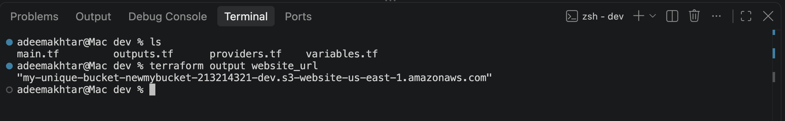
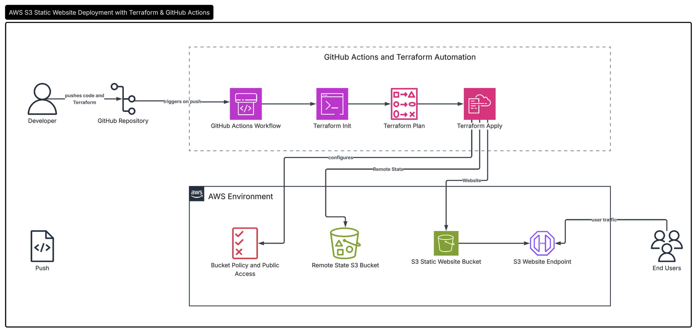
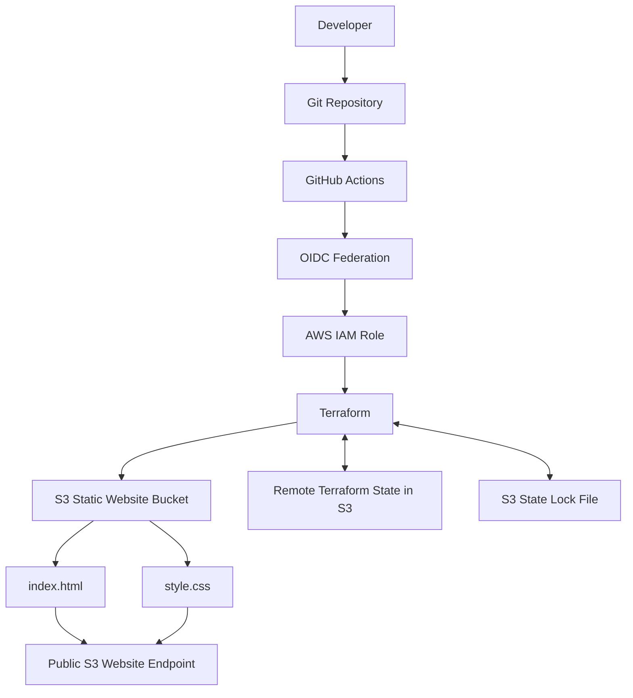
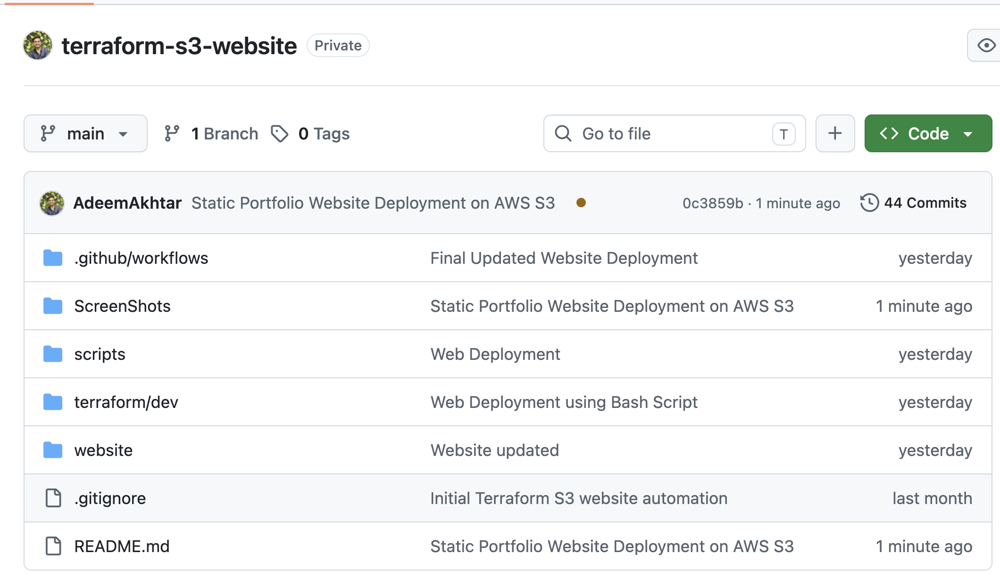
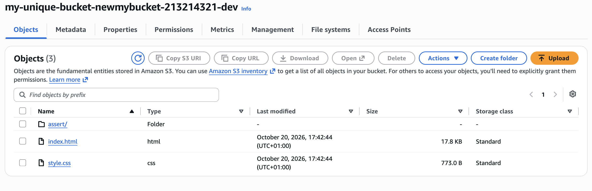
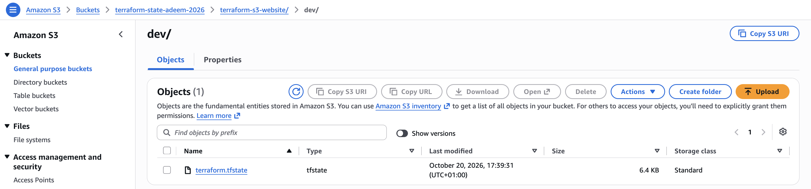
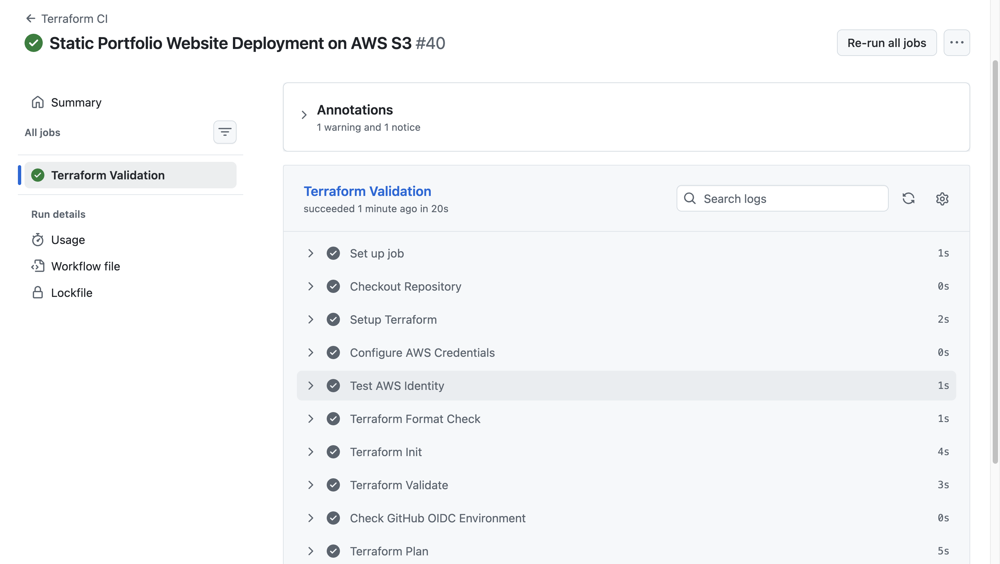
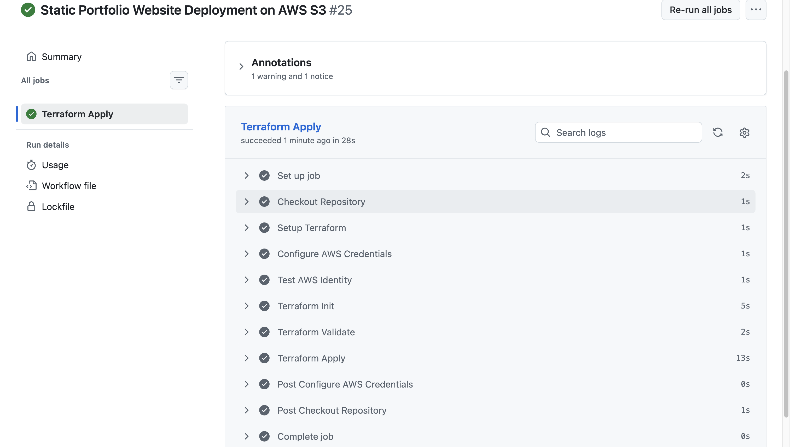
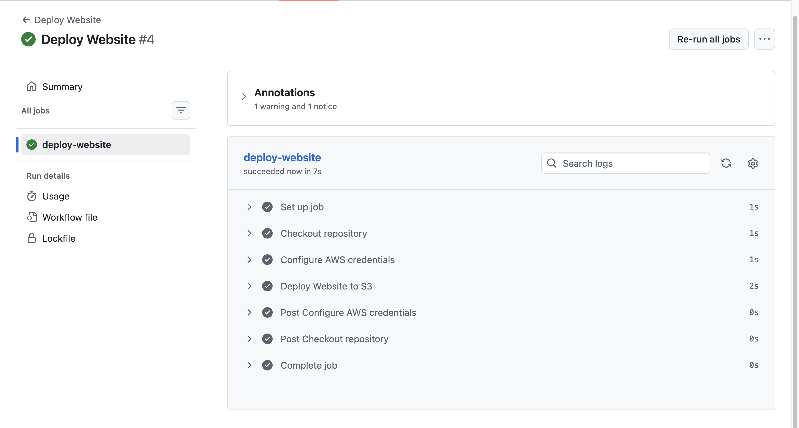

# Automated AWS S3 Static Website Deployment with Terraform & GitHub Actions


An Infrastructure as Code (IaC) project that provisions and manages an AWS S3 static website using Terraform and GitHub Actions. The project demonstrates automated infrastructure validation, deployment and destruction, remote Terraform state management, and secure GitHub-to-AWS authentication using OpenID Connect (OIDC).

## Project Overview

This project automates the lifecycle of a static website hosted on Amazon S3. Instead of manually creating and configuring AWS resources through the console, the infrastructure is declared in Terraform and managed through version-controlled configuration.

GitHub Actions provides separate workflows for continuous integration, deployment, and infrastructure destruction. GitHub OIDC enables workflows to assume an AWS IAM role without storing long-lived AWS access keys in GitHub secrets.



**Live website:** `http://my-unique-bucket-newmybucket-213214321-dev.s3-website-us-east-1.amazonaws.com/`

**GitHub repository:** https://github.com/AdeemAkhtar/terraform-s3-website

## Project Objectives

- Provision AWS infrastructure using Terraform.
- Host a static website on Amazon S3.
- Configure website hosting, public access and a bucket policy through code.
- Store Terraform state in a dedicated remote S3 bucket.
- Use S3-native state locking where configured.
- Automate Terraform checks through GitHub Actions.
- Authenticate GitHub Actions to AWS using OIDC.
- Provide dedicated deployment and destruction workflows.
- Make infrastructure changes reproducible and easier to review.

## Architecture





The architecture separates the application website bucket from the Terraform state bucket. The website bucket serves the static files, while the state bucket stores Terraform's record of the managed infrastructure.

The S3 website endpoint serves HTTP traffic. HTTPS and a custom domain are potential future enhancements using CloudFront and, if needed, Route 53.

## Technology Stack

| Technology | Purpose |
|---|---|
| Amazon S3 | Static website hosting and remote Terraform state |
| Terraform | Infrastructure as Code and resource lifecycle management |
| GitHub Actions | Automated CI, deployment and destruction workflows |
| AWS IAM | Permissions for Terraform operations |
| GitHub OIDC | Federated authentication to AWS |
| HCL | Terraform configuration language |
| Git and GitHub | Version control and collaboration |
| Bash | Shell commands and automation support |

## Repository Structure



```text
terraform-s3-website/
├── .github/
│   └── workflows/
│       ├── terraform-ci.yml
│       ├── terraform-deploy.yml
│       ├── deploy-website.yml
│       └── terraform-destroy.yml
├── terraform/
│   └── dev/
│       ├── providers.tf
│       ├── variables.tf
│       ├── main.tf
│       └── outputs.tf
├── website/
│   ├── assert/
│   │        ├── adeem-profile.png
│   │        └── adeem.jpeg
│   ├── index.html
│   └── style.css
├── scripts/
│       ├── deploy.sh
│       └── destory.sh
├── .gitignore
└── README.md
```

## How It Works

### 1. Infrastructure as Code with Terraform

Terraform declares the AWS resources required for the website, including:

- An S3 bucket for website files.
- S3 static website configuration.
- A public access block configured for the intended public website policy.
- An S3 bucket policy allowing public read access to website objects.
- S3 objects for `index.html`, `index.html` and `style.css`.
- Outputs for useful deployment information, including the bucket name and website endpoint.



Terraform references are used to connect resources and express dependencies rather than manually entering resource identifiers wherever possible.

### 2. Remote State Management

Terraform state is stored remotely in a dedicated S3 bucket rather than being treated as a local file.

Backend configuration:

- **Bucket:** `terraform-state-adeem-2026`
- **Region:** `us-east-1`
- **State key:** `terraform-s3-website/dev/terraform.tfstate`

Where enabled, S3-native lock-file support coordinates concurrent Terraform operations through a `.tflock` object.

Keeping the state bucket separate from the application infrastructure means the website can be destroyed without deleting the backend that Terraform needs for future deployments.

### 3. GitHub Actions CI Workflow

The CI workflow runs on pushes and pull requests targeting the `main` branch, as configured in the workflow.

Typical checks include:

1. Check out the repository.
2. Install the selected Terraform CLI version.
3. Authenticate to AWS using OIDC when AWS access is required.
4. Run `terraform fmt -check`.
5. Initialize Terraform.
6. Validate the configuration.
7. Generate a Terraform plan.

This provides early feedback on formatting, configuration errors and proposed infrastructure changes.

### 4. Secure Authentication with GitHub OIDC

The GitHub Actions workflows use an AWS IAM role through OpenID Connect federation.

The workflow requests an identity token from GitHub, and AWS STS exchanges the token for temporary role credentials when the IAM trust policy permits it.

Benefits include:

- No need to store permanent AWS access keys in GitHub secrets.
- Temporary credentials for workflow execution.
- IAM trust conditions that restrict which repository identities can assume the role.
- Centralised permission management through AWS IAM.

The GitHub repository contains the role ARN as a secret named `AWS_ROLE_ARN`. The IAM role must have the permissions required for the Terraform resources and remote state backend.

### 5. Deployment Workflow

The deployment workflow is manually triggered through GitHub Actions.

Its intended lifecycle is:

1. Check out the repository.
2. Configure Terraform.
3. Authenticate to AWS through OIDC.
4. Initialise the remote backend.
5. Validate the configuration.
6. Generate a Terraform plan.
7. Apply the planned changes.
8. Retrieve the website endpoint from Terraform outputs.





A deployment is complete only after the workflow succeeds and the website is verified in a browser. If the workflow uses a saved plan and a separate approval job, document that approval gate only after it has been implemented and tested.

### 6. Destruction Workflow

A separate manually triggered workflow runs Terraform destruction for the application infrastructure.

This supports repeatable cleanup of the website resources and helps control ongoing costs.

**Important:** The Terraform state bucket is a prerequisite for the backend and must be preserved during application destruction. Always review the destruction plan and confirm that the state bucket is not a managed deletion target.

### 7. Static Website Hosting

The website contains an HTML homepage, assert folder and a CSS stylesheet uploaded to S3.

The S3 website endpoint makes the site accessible without a separate web server or virtual machine.

Public website access is provided by an S3 bucket policy granting `s3:GetObject` for website objects. This is intentionally public: never upload secrets, personal data, credentials or private application files to this bucket.

## Prerequisites

- An AWS account.
- An S3 bucket created separately for Terraform state.
- An IAM OIDC identity provider for GitHub Actions.
- An IAM role with a correctly restricted trust policy and appropriate permissions.
- A GitHub repository with the `AWS_ROLE_ARN` secret configured.
- Terraform CLI installed locally for development and validation.
- Git installed locally.

## Run Locally

From the repository root:

```bash
terraform -chdir=terraform/dev fmt
terraform -chdir=terraform/dev init
terraform -chdir=terraform/dev validate
terraform -chdir=terraform/dev plan -var="environment=dev"
```

Review the plan before applying changes. For the first deployment, the plan should create the missing website resources if the remote state is empty and the configuration matches the intended infrastructure.

Apply locally only when you intentionally want to manage the deployment from your workstation and your AWS credentials and permissions are correctly configured. Otherwise, use the deployment workflow.

After deployment:

```bash
terraform -chdir=terraform/dev output
terraform -chdir=terraform/dev state list
```

Use the website URL output to open the site in a browser. Verify that the homepage and stylesheet load successfully.

## Security Considerations

- Use OIDC instead of long-lived AWS access keys for GitHub Actions.
- Restrict the OIDC trust policy to the intended repository and required identities.
- Apply least-privilege IAM permissions.
- Keep the remote state bucket private and protected.
- Protect state and lock-file objects with the permissions required by the backend.
- Make only the website content publicly readable.
- Never store secrets in Terraform configuration, outputs, website files or the repository.
- Review plans before applying or destroying resources.
- Be aware that S3 website endpoints use HTTP rather than HTTPS.

Public S3 hosting is suitable for a deliberately public static website. For a more production-oriented deployment, consider CloudFront with HTTPS and private S3 origin access.

## Troubleshooting and Lessons Learned

During development, the project involved practical troubleshooting of Terraform state, remote backend configuration, IAM permissions, GitHub OIDC authentication and workflow execution.

Key lessons include:

- Terraform state is essential for tracking managed resources.
- Remote backend configuration must remain consistent across local and CI environments.
- State locking helps prevent concurrent operations from modifying the same state.
- GitHub OIDC requires both a valid identity provider and a correctly configured IAM trust policy.
- Terraform validation alone does not prove that AWS resources can be deployed successfully.
- A successful deployment must be verified at the application endpoint.
- Destruction workflows need special care when the state backend is stored in S3.

## Future Improvements

Potential enhancements include:

- CloudFront distribution and HTTPS.
- Custom domain and DNS configuration.
- Separate development, staging and production environments.
- Automated website smoke tests.
- Monitoring, alerting and deployment notifications.
- Stronger CI/CD separation between plan, approval and apply.
- Additional security checks and policy validation.

These are future improvements rather than prerequisites for the current project's scope.

## What I Learned

This project provided hands-on experience with:

- Defining AWS infrastructure declaratively with Terraform.
- Managing remote state and state locking.
- Connecting GitHub Actions to AWS through OIDC.
- Automating infrastructure validation, deployment and destruction.
- Configuring public S3 static website hosting.
- Troubleshooting real infrastructure and CI/CD failures.
- Designing a repeatable deployment lifecycle with cost-aware cleanup.

## Conclusion

This project demonstrates an automated approach to AWS infrastructure management using Terraform and GitHub Actions. It combines Infrastructure as Code, federated authentication, remote state, CI/CD and an accessible static website into one practical Cloud/DevOps portfolio project.

The next step is to capture the final architecture and deployment evidence, keep the documentation aligned with the actual workflow implementation, and continue improving the project as new requirements emerge.
